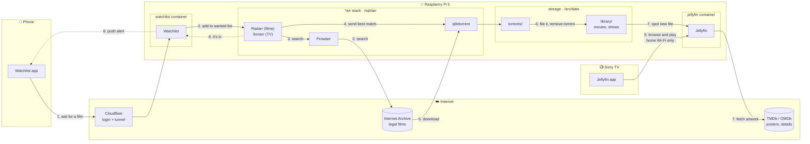

# How a film gets to the TV

The whole journey on one page. The numbers on the arrows are the order things happen. For the details behind each step, see [media-server.md](media-server.md).

| # | What happens |
| --- | --- |
| 1 | You name a film or a show in the watchlist chat on your phone. Cloudflare checks it's you before the request reaches the Pi. |
| 2 | The watchlist hands films to **Radarr** and shows (the whole series) to **Sonarr**. |
| 3 | Radarr or Sonarr searches through **Prowlarr**, which asks the Internet Archive (legal sources only). |
| 4 | The best match goes to **qBittorrent**. |
| 5 | qBittorrent downloads it into `/srv/data/torrents`, and stops when it's complete (no seeding). |
| 6 | Radarr or Sonarr gives it its proper name in `/srv/data/library`, then removes the torrent, so the library file is the only copy. |
| 7 | **Jellyfin** sees the new file within seconds and fetches its poster and details. |
| 8 | Radarr or Sonarr tells the watchlist, which sends a push alert to your phone. |
| 9 | You open the Jellyfin app on the TV and play it. This only works on the home Wi-Fi. |

**When you're done:** delete it in Jellyfin. The space is freed straight away, and it isn't downloaded again.
