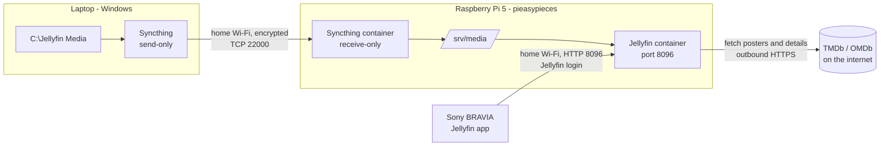

# Home media server

How films get from the laptop to the Sony TV, told in the order things happen. At each step: what happens, who proves what to whom, and what had to be set up beforehand.

Set up 2026-10-16. Home network only, by choice.

## The cast



| Who | What it is | Where |
| --- | --- | --- |
| **qBittorrent** | Downloads files | Laptop, `C:\qBittorrent` |
| **MediaTidy** | Gives each finished download its tidy name (this repo) | Laptop, run by qBittorrent |
| **Laptop** | Where films arrive and live as the master copy | `C:\Jellyfin Media` |
| **Syncthing (laptop)** | Background program that sends the folder's changes to the Pi | Starts hidden at Windows login |
| **Raspberry Pi** | Always-on box that stores and serves the films | `192.168.1.40`, home Wi-Fi |
| **Syncthing (Pi)** | Receives the folder from the laptop | Docker container `syncthing` |
| **Jellyfin** | Media server: organises the films, fetches artwork, streams to the TV | Docker container `jellyfin`, port 8096 |
| **Sony TV** | Google TV running the Jellyfin app | Home Wi-Fi |

The Pi also runs your website and the risky-business dev and prod stacks. The media setup is completely separate from them, apart from sharing the hardware.

## Before any of this: prerequisites

These existed already, or were set up once:

1. **A home network.** The Wi-Fi password is the first lock on everything below. Anyone not on your Wi-Fi cannot reach the media server at all.
2. **The Pi**, a Raspberry Pi 5 with 8 GB of RAM, on Wi-Fi at `192.168.1.40`, with the official 5 A power supply, so its USB ports can power external drives.
3. **Docker on the Pi**, already installed for risky-business. Both new programs run as containers.
4. **SSH access to the Pi** from the laptop with your `id_rsa` key. This is how everything on the Pi was installed and how it is administered.
5. **Storage**: the Pi's SD card, about 90 GB free. A 1 TB USB drive is planned to replace it.
6. **winget** on the laptop (Windows' package manager), used to install Syncthing.

## Concepts used below

| Concept | Meaning |
| --- | --- |
| **Container** | A program packaged with everything it needs, run in isolation by Docker. It can only see the folders and network it is given. Removing it leaves the rest of the Pi untouched. |
| **Pinned version** | Images are named with exact versions (`jellyfin/jellyfin:12.1`, `syncthing/syncthing:2.1.5`), so nothing changes unless you change it. Both were chosen to be a few weeks old rather than brand new. |
| **Host networking** | The containers use the Pi's own network directly, rather than a private Docker network. This is needed so the TV and the laptop can *discover* them by broadcasting on the home network. |
| **Bind mount** | A Pi folder made visible inside a container. `/srv/media` on the Pi appears as `/media` inside Jellyfin, **read-only**, so Jellyfin can never change or delete a film. |
| **User 1000** | Both containers run as your Linux user `upendra`, not as root, so files they create are yours. |
| **Library** | A Jellyfin collection of one content type pointing at a folder: **Movies** reads `/media/movies`, **Shows** reads `/media/shows`. The type decides how names are understood. |
| **Metadata** | Posters, plots, cast, ratings and collections. Jellyfin looks films up by name and year on **TMDb** (The Movie Database) and **OMDb** (which adds IMDb and Rotten Tomatoes ratings). |
| **Direct play** | The TV plays the file exactly as stored. The Pi just sends the bytes. The alternative, **transcoding** (converting on the fly), is slow on a Pi 5, which has no hardware video encoder. |
| **Send-only / receive-only** | Syncthing folder modes. The laptop only ever sends; the Pi only ever receives. Nothing on the Pi can change the laptop's files. |
| **Device ID** | Syncthing's identity for a machine: a fingerprint of a certificate the machine generated itself. Two machines only talk if **each has added the other's ID**. |
| **Mirror** | The Pi's folder always matches the laptop's. Deleting a film on the laptop deletes it on the Pi. |
| **`.stignore`** | The list of things Syncthing never sends: `_leftovers`, `.txt`/`.nfo` junk, screenshot folders, part-finished downloads. |

## The story of a film

### 0. A download finishes

- **What happens:** when qBittorrent finishes a download into `C:\qBittorrent`, it runs **MediaTidy** ([tools/media-tidy](../tools/media-tidy/)) with that download's path. MediaTidy:
  1. finds the main video (ignoring samples);
  2. works out whether it's a film (title and year) or an episode (`SxxEyy`);
  3. gives it its tidy name in `C:\Jellyfin Media`, along with any English subtitles.

  It does this with a **hard link**: a second name for the same data on the same drive. So no extra space is used, and qBittorrent keeps seeding under the original name.
  - A **ledger** remembers what has been filed, so a film you later delete is never put back.
  - Anything it can't work out is left alone and logged as **NEEDS YOU** in `%LOCALAPPDATA%\MediaTidy\mediatidy.log`.
- **Access:** none. Both programs run as you, on the laptop.
- **Set up once:**
  - MediaTidy was built from this repo and installed to `%LOCALAPPDATA%\MediaTidy\bin`.
  - In qBittorrent (**Options → Downloads**): **Append .!qB extension to incomplete files** is ticked, and **Run on torrent finished** is set to:

    ```text
    "C:\Users\upend\AppData\Local\MediaTidy\bin\MediaTidy.exe" --apply "%F"
    ```

### 1. A film lands on the laptop

- **What happens:** MediaTidy files the film into `C:\Jellyfin Media`, or you put it there yourself, in the layout Jellyfin understands:

  ```text
  movies\Toy Story (1995)\Toy Story (1995).mp4
  movies\Toy Story (1995)\Toy Story (1995).en.srt      English subtitles
  shows\MobLand\Season 02\MobLand S02E05.mkv
  ```

  The name and year drive the metadata lookup. Getting them right is most of the work.
- **Access:** you, logged in to Windows. Nothing else is involved yet.

### 2. Syncthing on the laptop notices

- **What happens:** Syncthing watches the folder. Within seconds it reads the new file, splits it into blocks, fingerprints each block, and records it in its own database.
- **Access:** none. This is local to the laptop.
- **Set up once:**
  - Syncthing 2.1.5 was installed with winget.
  - A Windows **scheduled task** called *Syncthing* starts it hidden at every login, including on battery.
  - Its auto-update is off, so winget is in charge of updates.
  - Its web page is at `http://127.0.0.1:8384`. It listens only on the laptop itself, so nothing else on the network can open it. It has no password, which is acceptable only because of that.

### 3. The laptop and the Pi recognise each other

- **What happens:** the laptop connects to the Pi at `192.168.1.40:22000`. Both sides present their certificates and check the other's fingerprint against the device ID they were given. If either one doesn't match, the connection is dropped.
- **Access:** **mutual TLS.** Each machine proves its identity with a private key it generated and never shares. No passwords are involved. The connection is encrypted end to end.
- **Set up once:**
  - Each side was given the other's device ID.
  - Both were restricted to the home network: **no global discovery** (they don't announce themselves to Syncthing's public servers), **no relays** (traffic never goes via a third party), and **no router port opening (NAT traversal)**.
  - So the only way they find each other is the laptop dialling the Pi's address directly, or the two hearing each other's broadcasts on the home network.

### 4. The film travels to the Pi

- **What happens:** the laptop tells the Pi what has changed. The Pi asks for the blocks it doesn't have, writes them to a hidden temporary file (`.syncthing.*.tmp`), checks every block's fingerprint, then renames the file into place under `/srv/media`.
- **Access:** inside the encrypted connection from step 3. The folder is shared only with that one device, by the folder ID `jellyfin-media`.
- **Speed:** about 5 MB/s over the Pi's Wi-Fi, so roughly 18 GB an hour. Renames and moves on the laptop don't resend the data; the Pi reuses blocks it already has.
- **Set up once:** Syncthing on the Pi runs in a container (`/opt/syncthing`), as user 1000, writing to `/srv/media`. Its web page listens only on the Pi itself (`127.0.0.1:8384`). To open it from the laptop, tunnel through SSH:

  ```bash
  ssh -L 8385:127.0.0.1:8384 upendra@192.168.1.40   # then open http://127.0.0.1:8385
  ```

### 5. Jellyfin notices and enriches the film

- **What happens:** Jellyfin watches `/media` for changes. When a new film appears, it:
  1. reads its name and year;
  2. looks it up **outbound** over HTTPS on TMDb and OMDb;
  3. saves the poster, background, plot, cast, ratings and collection in its own database (`/opt/jellyfin/config`).

  The film's folder is never written to, because it is read-only to Jellyfin. Overnight, Jellyfin also generates scrubbing previews and chapter thumbnails.
- **Access:** outbound only. Jellyfin uses its built-in access to TMDb and OMDb, and you have no accounts with them. Nothing on the internet connects in.
- **Set up once:**
  - **Jellyfin 12.1** in a container (`/opt/jellyfin`), limited to 3 of the 4 CPU cores so the website always has one.
  - **Libraries:** Movies and Shows, with English / United Kingdom metadata, folder watching on, collections on, and details refreshed every 30 days.
- **If it misses one** (it happens if files change while it is looking): Dashboard → Libraries → **Scan All Libraries**. If it matches the wrong film: open it and use **Identify**.

### 6. The TV finds the server

- **What happens:** the Jellyfin app on the TV broadcasts "any Jellyfin servers here?" on the home network (UDP port 7359). The Pi answers with its name and address, `http://192.168.1.40:8096`.
- **Access:** none needed to be found. Any device on your Wi-Fi can learn that a server exists, plus its name and version.
- **Set up once:** the Jellyfin app from Google Play on the TV.

### 7. You log in on the TV

- **What happens:** the app sends your Jellyfin username and password. Jellyfin checks them against the stored *hash* (a scrambled form; the password itself is never stored) and returns an **access token**. The app saves the token and sends it with every request from then on, so you don't type the password again. Jellyfin lists every logged-in device under **Dashboard → Devices**. Deleting a device there cancels its token, so that device has to log in again.
- **Access:** your **Jellyfin account**. This is separate from Windows, the Pi, Wi-Fi and everything else. It also decides what each user may do: admin accounts can change the server, ordinary users can only watch.
- **Note:** this is plain HTTP inside your home, not HTTPS. The Wi-Fi encryption protects it over the air, but a device already on your network could in theory capture it. That is acceptable at home, as long as the Jellyfin password isn't one you use anywhere else.

### 8. The film plays

- **What happens:** the app asks for the film with its token. Jellyfin checks the token and sends the file. The TV decodes H.264/H.265 video and AAC/AC3 audio itself, so the Pi just *direct plays* the file with almost no CPU.
- **Access:** the token from step 7, on every request.

### 9. Deleting a film

Delete it from `C:\Jellyfin Media` on the laptop. Syncthing deletes it on the Pi, and Jellyfin removes it from the library. Deleting it on the Pi alone doesn't work: the Pi's folder is receive-only, and its own changes are flagged as *locally changed* and can be reverted.

## Who can get in: every permutation

| Who or what | Trying to | Result | Why |
| --- | --- | --- | --- |
| You, on the laptop, in a browser | Use Jellyfin at `http://192.168.1.40:8096` | Allowed after login | On the home network, with a Jellyfin account |
| The Sony TV | Find and play films | Allowed after login | Discovery on the home network, then a Jellyfin token |
| A guest on your Wi-Fi with no Jellyfin account | Use Jellyfin | Sees the server's name and the login page only | Wi-Fi lets them reach it; the Jellyfin login stops them |
| A guest on your Wi-Fi | Connect to Syncthing on the Pi | Refused | Their device ID isn't known to the Pi |
| A guest on your Wi-Fi | Open either Syncthing web page | Can't reach it | Both listen only on `127.0.0.1` |
| Anyone on the internet | Reach Jellyfin directly | Can't | No router port forwarding, and Jellyfin's **remote connections are off**, so it refuses non-home addresses even if a port were ever opened |
| Anyone on the internet | Via your Cloudflare domain | Can't | The tunnel only serves the website and risky-business; any other name gets a 404 |
| Anyone on the internet | Find your Syncthing devices | Can't | Global discovery, relays and NAT traversal are all off |
| You, from outside the house | Watch anything | Can't, by choice | Options for later: Tailscale (recommended) or a direct subdomain with Caddy and port forwarding. The Cloudflare tunnel is ruled out, because its terms forbid video and it would put the website at risk |
| You, administering the Pi | SSH in | Allowed | `id_rsa` private key on the laptop; its public half in the Pi's `authorized_keys`. Home network only |
| Claude Code, from the laptop | Administer the Pi | Allowed while you run it | Uses your SSH key from your session; no separate access exists |
| Jellyfin | Fetch metadata | Allowed, outbound only | HTTPS to TMDb and OMDb; nothing comes back in unasked |
| The Pi | Download container updates | Only when someone runs a pull | Anonymous pulls of pinned versions from Docker Hub |
| Anyone holding the Pi or its SD card | Read the films | Possible | The card isn't encrypted. Physical security is the only protection |
| The website and risky-business containers | Touch the media | Can't | Separate containers, networks and folders |

**In short:** to watch, you must be **on the home Wi-Fi** *and* have a **Jellyfin account**. To change what's stored, you must be **on the laptop**. To administer, you need the **SSH key**.

## Bulk loading with a USB stick

For tens of GB at once, a stick can be quicker than Wi-Fi: 7.7 GB took about 5 minutes onto the stick, then about 14 minutes into the Pi. The order matters:

1. **Pause** the folder in Syncthing on the laptop, so it doesn't start sending over Wi-Fi.
2. Put the films into `C:\Jellyfin Media` in the right layout, then copy them to the stick, which is formatted exFAT so it can hold files over 4 GB.
3. Eject the stick and plug it into a blue USB 3 port on the Pi. The Pi's desktop mounts it at `/media/upendra/<label>`.
4. Copy it into `/srv/media`, check the copies against the laptop's checksums, then unmount the stick.
5. **Make the Pi's Syncthing rescan its folder**, so it knows the files are there.
6. Only then **un-pause** on the laptop. Syncthing confirms the files match and sends nothing.

If step 5 is skipped, the Pi doesn't know it has the files and downloads them all again over Wi-Fi. That happened once. If a file then shows as *locally changed* on the Pi, **Revert Local Changes** rebuilds it from what's already on the Pi, with no download.

## Day to day

| Task | How |
| --- | --- |
| Add a film | Download it with qBittorrent; MediaTidy files it. Or put it in `C:\Jellyfin Media\movies\Title (Year)\Title (Year).ext` yourself. It's on the TV a few minutes later. |
| A download didn't appear | Check `%LOCALAPPDATA%\MediaTidy\mediatidy.log` for **NEEDS YOU**. To re-check every download: `MediaTidy.exe` (dry run), then `MediaTidy.exe --apply` |
| Add episodes | `C:\Jellyfin Media\shows\Show\Season NN\Show SxxEyy.ext` |
| Remove a film | Delete it from `C:\Jellyfin Media`, and remove the torrent with its files in qBittorrent. The space is only freed once both names are gone. |
| A film is missing or wrong | Jellyfin: **Scan All Libraries**, or **Identify** on the film |
| Is the sync up to date? | Laptop: `http://127.0.0.1:8384` |
| Restart a service | On the Pi: `cd /opt/jellyfin && docker compose restart` (or `/opt/syncthing`) |
| Update Jellyfin or Syncthing on the Pi | Change the version in that folder's `compose.yaml`, then `docker compose up -d` |
| Update Syncthing on the laptop | `winget upgrade Syncthing.Syncthing`, then point the *Syncthing* scheduled task at the new folder: the program's path includes its version number |

## Where things are

| Thing | Location |
| --- | --- |
| Downloads | Laptop, `C:\qBittorrent` (the original names, kept for seeding) |
| MediaTidy | Source in [tools/media-tidy](../tools/media-tidy/); installed in `%LOCALAPPDATA%\MediaTidy\bin`; log and ledger in `%LOCALAPPDATA%\MediaTidy` |
| Master copy of the media | Laptop, `C:\Jellyfin Media` (`_leftovers\` is never synced) |
| Synced media | Pi, `/srv/media/movies`, `/srv/media/shows` |
| Jellyfin | Pi, `/opt/jellyfin/compose.yaml` (copy in [pi/jellyfin](../pi/jellyfin/compose.yaml)), settings and database in `/opt/jellyfin/config` |
| Jellyfin home-only setting | `/opt/jellyfin/config/config/network.xml` (`EnableRemoteAccess=false`, backup alongside) |
| Syncthing (Pi) | `/opt/syncthing/compose.yaml` (copy in [pi/syncthing](../pi/syncthing/compose.yaml)), settings in `/opt/syncthing/data` |
| Syncthing (laptop) | Program installed by winget; settings in `%LOCALAPPDATA%\Syncthing`; started by the *Syncthing* scheduled task |
| Ignore list | `C:\Jellyfin Media\.stignore` (copy in [laptop/syncthing](../laptop/syncthing/.stignore)) |
| Web pages | Jellyfin `http://192.168.1.40:8096`; Syncthing on the laptop `http://127.0.0.1:8384` |

## Known limits

- **Converting video:** the Pi can manage about one 1080p conversion at a time. Files the TV plays directly are always best.
- **Wi-Fi:** the Pi's built-in Wi-Fi, plus both machines sharing the air, limits syncing to about 5 MB/s, even with a strong 5 GHz signal.
- **SD card:** everything, including the risky-business prod database, lives on the SD card for now.

Planned improvements are in the [roadmap](roadmap.md).
