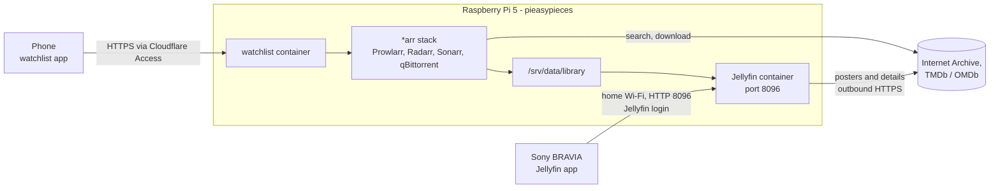
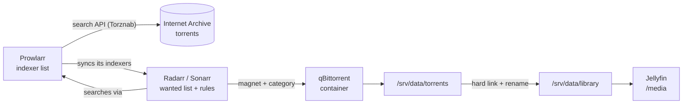

# Home media server

How films and shows get to the Sony TV, and how they leave again. At each step: what happens, who proves what to whom, and what had to be set up beforehand.

Set up 2026-10-16. Everything runs in Docker containers on the Pi. Home network only, by choice. For the one-page picture, see **[journey.md](journey.md)**.

## The cast



| Who | What it is | Where |
| --- | --- | --- |
| **Raspberry Pi** | Always-on box that fetches, stores and serves the films | `192.168.1.40`, home Wi-Fi |
| **Watchlist** | Chat app: add films, release alerts, the Status tab; sends films to Radarr and TV to Sonarr | Docker container `watchlist`, `chat.upendragusain.co.uk` |
| **Prowlarr** | Keeps the list of indexers (legal sources only) and searches them | Docker container in `/opt/arr` |
| **Radarr / Sonarr** | Wanted lists for films / TV: pick a release, send it to qBittorrent, file the result | Docker containers in `/opt/arr` |
| **qBittorrent** | Downloads, then stops (no seeding) | Docker container in `/opt/arr` |
| **Jellyfin** | Media server: organises the films, fetches artwork, streams to the TV | Docker container `jellyfin`, port 8096 |
| **Sony TV** | Google TV running the Jellyfin app | Home Wi-Fi |
| **Laptop** | Used only to administer the Pi (SSH) and to deploy the watchlist | Home Wi-Fi |

The Pi also runs your website and the risky-business dev and prod stacks. The media setup is completely separate from them, apart from sharing the hardware.

## Before any of this: prerequisites

These existed already, or were set up once:

1. **A home network.** The Wi-Fi password is the first lock on everything below. Anyone not on your Wi-Fi cannot reach Jellyfin at all.
2. **The Pi**, a Raspberry Pi 5 with 8 GB of RAM, on Wi-Fi at `192.168.1.40`, with the official 5 A power supply, so its USB ports can power external drives.
3. **Docker on the Pi**, already installed for risky-business. Everything here runs as containers.
4. **SSH access to the Pi** from the laptop with your `id_rsa` key. This is how everything on the Pi was installed and how it is administered.
5. **Storage**: the Pi's SD card, about 87 GB free (2026-10-18). A 1 TB USB drive is planned to replace it.
6. **A Cloudflare tunnel** on the Pi (already there for the website), so the watchlist can be reached from your phone anywhere, behind Cloudflare Access.

## Concepts used below

| Concept | Meaning |
| --- | --- |
| **Container** | A program packaged with everything it needs, run in isolation by Docker. It can only see the folders and network it is given. Removing it leaves the rest of the Pi untouched. |
| **Pinned version** | Images are named with exact versions (`jellyfin/jellyfin:12.1`, and so on), so nothing changes unless you change it. Each was chosen to be a few weeks old rather than brand new. |
| **Host networking** | Jellyfin uses the Pi's own network directly, rather than a private Docker network, so the TV can *discover* it by broadcasting on the home network. |
| **Bind mount** | A Pi folder made visible inside a container. `/srv/data/library` on the Pi appears as `/media` inside Jellyfin. It's writable, so you can delete what you've watched from Jellyfin. |
| **Indexer** | A searchable catalogue of downloads. Here, only the Internet Archive. |
| **Hard link** | A second name for the same data on the same drive, using no extra space. Radarr and Sonarr import downloads this way; the space is freed only when every name is gone, which is why finished torrents are removed straight after import. |
| **User 1000** | The containers run as your Linux user `upendra`, not as root, so files they create are yours. |
| **Library** | A Jellyfin collection of one content type pointing at a folder: **Movies** reads `/media/movies`, **Shows** reads `/media/shows`. The type decides how names are understood. |
| **Metadata** | Posters, plots, cast, ratings and collections. Jellyfin looks films up by name and year on **TMDb** (The Movie Database) and **OMDb** (which adds IMDb and Rotten Tomatoes ratings). |
| **Direct play** | The TV plays the file exactly as stored. The Pi just sends the bytes. The alternative, **transcoding** (converting on the fly), is slow on a Pi 5, which has no hardware video encoder. |

## The story of a film

Steps 1–4 are the *arr pipeline, summarised here; [its own section](#the-arr-pipeline-public-domain-titles) has the details.

### 1. You ask for it

- **What happens:** you name a film in the watchlist chat on your phone, and it goes to Radarr. A whole series, a season or an episode goes to Sonarr, but only when you ask for it explicitly. You can also add titles in Radarr or Sonarr by hand.
- **Access:** Cloudflare Access lets only `upendra.gusain@gmail.com` reach the watchlist, and the watchlist checks Access's signed token too. Inside the Pi, the watchlist talks to Radarr and Sonarr over their private Docker network, with their API keys.

### 2. Radarr or Sonarr searches

- **What happens:** the app searches through Prowlarr, which queries the legal indexers. Every result is checked against the app's quality profile, size limits and blocklist, and the best one is chosen.
- **Access:** outbound HTTPS from the Pi to the Internet Archive. Nothing connects in.

### 3. qBittorrent downloads it

- **What happens:** the chosen release goes to qBittorrent with the category `radarr` or `sonarr`. It downloads into `/srv/data/torrents`, and **stops when complete**: nothing seeds.
- **Access:** qBittorrent trusts requests from the stack's Docker network without a password. Its peer port 6881 is open to the home network only.

### 4. The film is filed

- **What happens:** Radarr gives the file its tidy name with a **hard link**, then **removes the torrent and its data**, so the library file is the only copy:

  ```text
  movies/Toy Story (1995)/Toy Story (1995).mp4
  shows/MobLand/Season 02/MobLand S02E05.mkv
  ```

  Radarr's webhook then tells the watchlist, so the card moves to *in library* and your phone gets an alert.

### 5. Jellyfin notices and enriches the film

- **What happens:** Jellyfin watches `/media` for changes. When a new film appears, it:
  1. reads its name and year;
  2. looks it up **outbound** over HTTPS on TMDb and OMDb;
  3. saves the poster, background, plot, cast, ratings and collection in its own database (`/opt/jellyfin/config`).

  Jellyfin only writes to the film's folder when you delete it. Overnight, Jellyfin also generates scrubbing previews and chapter thumbnails.
- **Access:** outbound only. Jellyfin uses its built-in access to TMDb and OMDb, and you have no accounts with them. Nothing on the internet connects in.
- **Set up once:**
  - **Jellyfin 12.1** in a container (`/opt/jellyfin`), limited to 3 of the 4 CPU cores so the website always has one.
  - **Libraries:** Movies and Shows, with English / United Kingdom metadata, folder watching on, collections on, and details refreshed every 30 days.
- **If it misses one** (it happens if files change while it is looking): Dashboard → Libraries → **Scan All Libraries**. If it matches the wrong film: open it and use **Identify**.

### 6. The TV finds the server

- **What happens:** the Jellyfin app on the TV broadcasts "any Jellyfin servers here?" on the home network (UDP port 7359). The Pi answers with its name and address, `http://192.168.1.40:8096`.
- **Access:** none needed to be found. Any device on your Wi-Fi can learn that a server exists, plus its name and version.
- **Set up once:** the Jellyfin app from Google Play on the TV.

### 7. You log in on the TV

- **What happens:** the app sends your Jellyfin username and password. Jellyfin checks them against the stored *hash* (a scrambled form; the password itself is never stored) and returns an **access token**. The app saves the token and sends it with every request from then on, so you don't type the password again. Jellyfin lists every logged-in device under **Dashboard → Devices**. Deleting a device there cancels its token, so that device has to log in again.
- **Access:** your **Jellyfin account**. This is separate from the Pi, Wi-Fi and everything else. It also decides what each user may do: admin accounts can change the server, ordinary users can only watch.
- **Note:** this is plain HTTP inside your home, not HTTPS. The Wi-Fi encryption protects it over the air, but a device already on your network could in theory capture it. That is acceptable at home, as long as the Jellyfin password isn't one you use anywhere else.

### 8. The film plays

- **What happens:** the app asks for the film with its token. Jellyfin checks the token and sends the file. The TV decodes H.264/H.265 video and AAC/AC3 audio itself, so the Pi just *direct plays* the file with almost no CPU.
- **Access:** the token from step 7, on every request.

### 9. Deleting a film

- **How:** in Jellyfin (the film's **⋮ → Delete media**; your user needs *Allow media deletion*, Dashboard → Users), with the watchlist's **Delete file** button, or in Radarr/Sonarr. Anything else (files you copied in yourself): delete its folder in `/srv/data/library`.
- **The space comes back at once:** nothing seeds, so the library file is the only copy. [pi/arr/reclaim.py](../pi/arr/reclaim.py) is a safety net for any torrent left behind.
- **It isn't downloaded again:** Radarr and Sonarr **unmonitor** what you deleted (set by setup.py), and the watchlist card leaves the download flow, back to release tracking, with no more searching.
- **To have it again:** ask for it in the chat. The watchlist re-monitors it in Radarr and searches.

## Who can get in: every permutation

| Who or what | Trying to | Result | Why |
| --- | --- | --- | --- |
| You, in a browser at home | Use Jellyfin at `http://192.168.1.40:8096` | Allowed after login | On the home network, with a Jellyfin account |
| The Sony TV | Find and play films | Allowed after login | Discovery on the home network, then a Jellyfin token |
| A guest on your Wi-Fi with no Jellyfin account | Use Jellyfin | Sees the server's name and the login page only | Wi-Fi lets them reach it; the Jellyfin login stops them |
| A guest on your Wi-Fi | Open Prowlarr, Radarr, Sonarr or qBittorrent | Can't reach them | All listen only on `127.0.0.1`; only qBittorrent's peer port 6881 is open, to the home network |
| Anyone on the internet | Reach Jellyfin directly | Can't | No router port forwarding, and Jellyfin's **remote connections are off**, so it refuses non-home addresses even if a port were ever opened |
| Anyone on the internet | Via your Cloudflare domain | Can't | The tunnel only serves the website, risky-business and `chat.upendragusain.co.uk`; any other name gets a 404 |
| Anyone on the internet | Use the watchlist at `chat.upendragusain.co.uk` | Can't | Cloudflare Access app *chat* lets in only `upendra.gusain@gmail.com` (emailed one-time code, login lasts a month), and the app checks Access's signed token too. It has no direct access to the media; through Radarr it can fetch a film or delete a downloaded one, and its Status tab only reads Prowlarr, Radarr and Sonarr (plus "test indexer") |
| You, from outside the house | Watch anything | Can't, by choice | Options for later: Tailscale (recommended) or a direct subdomain with Caddy and port forwarding. The Cloudflare tunnel is ruled out, because its terms forbid video and it would put the website at risk |
| You, administering the Pi | SSH in | Allowed | `id_rsa` private key on the laptop; its public half in the Pi's `authorized_keys`. Home network only |
| Claude Code, from the laptop | Administer the Pi | Allowed while you run it | Uses your SSH key from your session; no separate access exists |
| Jellyfin | Fetch metadata | Allowed, outbound only | HTTPS to TMDb and OMDb; nothing comes back in unasked |
| The Pi | Download container updates | Only when someone runs a pull | Anonymous pulls of pinned versions from Docker Hub |
| Anyone holding the Pi or its SD card | Read the films | Possible | The card isn't encrypted. Physical security is the only protection |
| The website and risky-business containers | Touch the media | Can't | Separate containers, networks and folders |

**In short:** to watch, you must be **on the home Wi-Fi** *and* have a **Jellyfin account**. To change what's stored: the watchlist (behind Cloudflare Access), or the **SSH key** for the Pi. To administer, you need the **SSH key**.

## Copying films in yourself

Anything in the right layout under `/srv/data/library` shows up in Jellyfin within seconds; Radarr and Sonarr don't need to know about it.

```text
/srv/data/library/movies/Title (Year)/Title (Year).ext
/srv/data/library/movies/Title (Year)/Title (Year).en.srt      English subtitles
/srv/data/library/shows/Show/Season NN/Show SxxEyy.ext
```

- **Over the network**, from Git Bash on the laptop: `scp -o HostKeyAlias=pieasypieces -r "Toy Story (1995)" upendra@192.168.1.40:/srv/data/library/movies/`. About 5 MB/s over the Pi's Wi-Fi, so roughly 18 GB an hour.
- **With a USB stick**, for tens of GB at once (formatted exFAT so it can hold files over 4 GB): plug it into a blue USB 3 port on the Pi. The Pi's desktop mounts it at `/media/upendra/<label>`. Copy into the library, then unmount the stick.

The name and year drive the metadata lookup, so getting them right is most of the work.

## Day to day

| Task | How |
| --- | --- |
| Add a film | Say it in the watchlist chat; Radarr downloads it if a legal source has it. Or [copy it in yourself](#copying-films-in-yourself) |
| Add episodes | Ask the watchlist chat to download a whole series, a season or one episode; Sonarr searches the configured legal indexers. Or copy it in yourself |
| Remove a film or episode | Delete it in Jellyfin (or the watchlist's **Delete file**). The space is freed straight away and it isn't downloaded again; to have it back, ask for it in the chat |
| Is the download pipeline OK? | The watchlist's **Status** tab: every indexer, and whether Radarr and Sonarr can reach qBittorrent and import. **Test now** lifts a paused indexer. Alerts come for anything broken for half an hour |
| A download is stuck at ~99% | `python3 /opt/arr/unstick.py --apply` on the Pi (or let its cron line do it) |
| Try another indexer | `.\pi\arr\indexers.ps1` from the laptop (see [The *arr pipeline](#the-arr-pipeline-public-domain-titles)) |
| Re-apply the *arr settings | `sudo python3 /opt/arr/setup.py` on the Pi (safe to re-run) |
| A film is missing or wrong | Jellyfin: **Scan All Libraries**, or **Identify** on the film |
| Restart a service | On the Pi: `cd /opt/jellyfin && docker compose restart` (or `/opt/arr`, `/opt/watchlist`). Start `/opt/arr` before `/opt/watchlist`, which joins its network |
| Update Jellyfin or the *arr apps | Change the version in that folder's `compose.yaml` (and the copy in `pi/`), then `docker compose up -d` |
| Update the watchlist | `services/watchlist/deploy.sh` from Git Bash on the laptop |

## Where things are

| Thing | Location |
| --- | --- |
| The library (what Jellyfin shows) | Pi, `/srv/data/library/movies`, `/srv/data/library/shows` (`/media/...` inside Jellyfin) |
| Downloads | Pi, `/srv/data/torrents`: only while downloading; empty otherwise (no seeding) |
| Jellyfin | Pi, `/opt/jellyfin/compose.yaml` (copy in [pi/jellyfin](../pi/jellyfin/compose.yaml)), settings and database in `/opt/jellyfin/config` |
| Jellyfin home-only setting | `/opt/jellyfin/config/config/network.xml` (`EnableRemoteAccess=false`, backup alongside) |
| *arr stack | Pi, `/opt/arr/compose.yaml` (copy in [pi/arr](../pi/arr/compose.yaml)), settings in `/opt/arr/{prowlarr,radarr,sonarr,qbittorrent}` |
| *arr scripts | Pi, `/opt/arr/{setup,indexers,unstick,reclaim}.py` (copies in [pi/arr](../pi/arr/)); logs `/opt/arr/{unstick,reclaim}.log` once their cron lines are in |
| Watchlist | Pi, `/opt/watchlist` (`compose.yaml`, `.env` with secrets, `data/watchlist.db`); code in [services/watchlist](../services/watchlist/) |
| Cloudflare tunnel | Pi, `cloudflared` system service, `/etc/cloudflared/config.yml` (dated backups alongside; not in any repo) |
| Cloudflare Access | Zero Trust team `upendragusain`, app *chat* covering `chat.upendragusain.co.uk`, policy *Only me* |
| Web pages | Jellyfin `http://192.168.1.40:8096`; watchlist `https://chat.upendragusain.co.uk`; the *arr apps through an SSH tunnel (below) |

## The *arr pipeline (public-domain titles)

Set up 2026-10-17 with **legal indexers only**. Its library folder is the one Jellyfin shows.



1. **You request a title:** say a film in the watchlist chat to send it to Radarr, or explicitly ask for a whole TV series, season or episode to send it to Sonarr. You can also add it in either app by hand.
2. **Radarr or Sonarr searches** through Prowlarr, which queries the configured legal indexers. Every result is parsed and checked against the app's profile, size limits and blocklist.
3. **The best release goes to qBittorrent** with the category `radarr` or `sonarr`.
4. **When it finishes, qBittorrent stops it** (share limit: ratio 0, then stop; set by setup.py), and **Radarr hard-links the file** into `/srv/data/library/movies/Title (Year)/`, renamed. Radarr then **removes the torrent and its data** (*Remove completed downloads* on the download client), so the library file is the only copy. Nothing seeds.
5. **Jellyfin** sees it within seconds (live monitoring is on), in `/media/movies`.
6. **Radarr's webhook** calls the watchlist (`http://watchlist:8190/hooks/radarr`, user `radarr` and a secret from the watchlist's `.env`), so the card moves to *downloading*, then *in library*, and your phone gets an alert. The watchlist container is on the same Docker network for this. When the file is deleted later, the webhook takes the card out of the download flow.

- **Indexers:** only the Internet Archive, set up in Prowlarr, which copies it to Radarr and Sonarr. Studio films aren't on legal indexers, so this pipeline won't find your watchlist titles; that's expected. Prowlarr's catalogue has ~580 definitions, but almost all are piracy sites or private trackers; on 2026-10-18 The Pirate Bay and LimeTorrents had been added by hand and were removed. Keep it to legal sources.
- **Adding or trying indexers:** [pi/arr/indexers.py](../pi/arr/indexers.py), run from the laptop through [indexers.ps1](../pi/arr/indexers.ps1), which pipes it to the Pi over SSH, so there is nothing to deploy. It only adds definitions on its `LEGAL` list, or a Torznab/Newznab feed of your own:

  ```powershell
  .\pi\arr\indexers.ps1 list                                   # what's there, paused or not, which apps get it
  .\pi\arr\indexers.ps1 test "Internet Archive"                # a pass lifts a pause
  .\pi\arr\indexers.ps1 search "Internet Archive" "Nosferatu"  # what that indexer alone returns
  .\pi\arr\indexers.ps1 add internetarchive                    # a definition on the LEGAL list
  .\pi\arr\indexers.ps1 add-torznab "My feed" https://feed.example/api KEY
  .\pi\arr\indexers.ps1 remove "My feed"
  ```

  If PowerShell refuses to run scripts, use `powershell -ExecutionPolicy Bypass -File .\pi\arr\indexers.ps1 list`. Prowlarr copies each change to Radarr and Sonarr itself (full sync).
- **Status tab (watchlist):** every 15 minutes the watchlist reads Prowlarr, Radarr and Sonarr (read-only, keys in its `.env`, filled in by setup.py). Per indexer: searches and failures in the last 24 hours, from Prowlarr's history and log, with each failure sorted into a kind. Timeouts, rate limits, network and server errors are **transient** (a warning: Prowlarr's own back-off retries them). A refused login, a Cloudflare block, a broken definition, or failing on and off for **over a day** is **persistent** (broken). Per app: health (minus the RSS warning, which is on purpose), a live test of qBittorrent, stuck imports in the queue, the last import, and whether it has every indexer Prowlarr syncs. Anything *broken* for 30 minutes sends one push alert, and another when it's fixed (quiet hours respected). Retrying is deliberately gentle: Prowlarr's back-off, the **Test now** button, and the daily re-search. Nothing hammers archive.org.
- **Quality profile Watchlist** (made by setup.py): Unknown and SD to 1080p, no upgrades. Internet Archive names rarely state a quality, so Radarr calls most of them *Unknown*, and the built-in HD profiles reject them. Avoid *Any*: it ranks a 59 GB 4K remux first and lets trailers through.
- **How Radarr chooses:** quality first (1080p beats 720p beats SD beats Unknown), then the custom-format score, then the size closest to "preferred". The Watchlist profile rejects anything scoring below 0:

  | Custom format | Score | Effect |
  | --- | --- | --- |
  | Over 5 GB | −10000 | Never downloads more than 5 GB |
  | Trailer or sample | −10000 | Skips trailers, teasers, samples |
  | Looks HD | +100 | Prefers names saying 720p, 1080p, HD, Blu-ray, WEB-DL |

  To change them: Radarr → **Settings → Custom Formats** (the rules) and **Settings → Profiles → Watchlist** (the scores, and which qualities are allowed and in what order).
- **Internet Archive quirks:**
  - An item holds several formats (`.mp4`, `.ogv`, `.mp3`, thumbnails) plus `_meta.xml`/`_meta.sqlite` files that change after the torrent is made, so they **never finish**, and Radarr waits for the whole torrent. qBittorrent therefore skips them (*Excluded file names*: the `_meta` files, thumbnails, `.ogv`, `.gif`, `.png`, the `.asr` transcripts), set by setup.py. Without that, downloads stall at 99.9%.
  - **Downloads stuck one piece short:** a piece can straddle the end of the video and the start of a skipped file, and qBittorrent won't fetch a skipped file's bytes from archive.org's web seeds, so the torrent sits at ~99% forever (seen 2026-10-18). [pi/arr/unstick.py](../pi/arr/unstick.py) wants the neighbouring file for a moment, waits for the shared piece, then skips it again. qBittorrent names unfinished files `.!qB` (setup.py), so the partial extra is never imported: Sonarr once imported a half-fetched `.ogv` instead of the `.mp4`. Meant for upendra's crontab, every 5 minutes (**not installed yet**, see the roadmap's housekeeping): `*/5 * * * * python3 /opt/arr/unstick.py --apply >> /opt/arr/unstick.log 2>&1`.
  - **RSS is off** (Prowlarr's sync profile *Standard*): the archive's "newest first" listing is too slow, and each timeout **pauses the indexer**, blocking real searches. Only searches for a named title run. Radarr and Sonarr therefore show an "RSS sync" health warning; it's expected, and the Status tab hides it.
  - **archive.org slows down Prowlarr on purpose:** the same search takes ~0.5 s with most User-Agents and 40–95 s with Prowlarr's (tested 2026-10-18), so Prowlarr sometimes times out and pauses the indexer for a while (its back-off; longer after each failure in a row). We don't disguise Prowlarr to get round it; that's the Internet Archive's call. To lift a pause: **Test now** on the Status tab, or `.\pi\arr\indexers.ps1 test "Internet Archive"`. Searches are retried: the watchlist's daily check asks Radarr to search again for every film still *looking for a copy*, and saying the film again in the chat re-sends a search too.
- **Sonarr and the Internet Archive:** Sonarr searches for exact episodes ("One Step Beyond S01E01", or "S01" for a season), and archive.org matches titles only, where uploads are named like "One Step Beyond S1 E1 The Bride Possessed". So Sonarr's own searches find nothing (tested 2026-10-18), though it parses those names fine. What works: find the item (`indexers.ps1 search "Internet Archive" "One Step Beyond Bride"`), then hand it to Sonarr with its *push release* API (`POST /api/v3/release/push` with the title and `https://archive.org/download/<id>/<id>_archive.torrent`). The series and episode must be monitored. Sonarr then sends it to qBittorrent and imports it like any grab, as a hard link (tested end to end with *One Step Beyond* S01E01).
- **Wiring:** [pi/arr/setup.py](../pi/arr/setup.py) sets up, through the apps' APIs: the root folders, renaming, the download client, the indexer, the Prowlarr links, the Watchlist profile and custom formats in **both** Radarr and Sonarr, "unmonitor deleted files", qBittorrent's skipped files, `.!qB` for unfinished files and **no seeding** (ratio 0, then stop), Radarr's webhook, and the watchlist's `.env` (Radarr, Prowlarr and Sonarr addresses and keys). It's safe to re-run: `sudo python3 /opt/arr/setup.py` (sudo because it writes the watchlist's `.env`).
- **Space back after deleting:** [pi/arr/reclaim.py](../pi/arr/reclaim.py), deployed to `/opt/arr`. Normally there's nothing for it to do (Radarr and Sonarr remove finished torrents); a safety net for upendra's crontab, hourly (**not installed yet**): `17 * * * * python3 /opt/arr/reclaim.py --apply >> /opt/arr/reclaim.log 2>&1`. First run 2026-10-18 freed 1.2 GB (Nosferatu, deleted in Jellyfin). It keeps a torrent that was never imported, is still in an app's queue, or still has a file in the library.
- **qBittorrent** skips its password for requests from the stack's Docker network (`172.20.0.0/16`), so the apps need no password for it. Its web page and the three apps listen on the Pi only. It doesn't seed: each torrent stops when complete, and Radarr/Sonarr remove it after importing.
- **API keys** are in each app's `config.xml` under `/opt/arr`; the scripts read them from there. Never print them.
- **Logins:** the first time you open Radarr, Sonarr or Prowlarr, it asks you to choose a login; set *Authentication required* to *Disabled for local addresses*, and create your own username and password.

To open the web pages from the laptop, tunnel through SSH (leave the window open while you use them), then browse to `http://localhost:<port>`. Changes made there apply at once; a change to Prowlarr's indexers reaches Radarr and Sonarr within seconds (full sync):

```powershell
& "C:\Program Files\Git\usr\bin\ssh.exe" -N -o HostKeyAlias=pieasypieces -L 9696:127.0.0.1:9696 -L 7878:127.0.0.1:7878 -L 8989:127.0.0.1:8989 -L 8085:127.0.0.1:8085 upendra@192.168.1.40
```

| App | Port |
| --- | --- |
| Prowlarr | 9696 |
| Radarr | 7878 |
| Sonarr | 8989 |
| qBittorrent | 8085 |

## Known limits

- **Converting video:** the Pi can manage about one 1080p conversion at a time. Files the TV plays directly are always best.
- **Wi-Fi:** the Pi's built-in Wi-Fi manages about 5 MB/s for copying files in, even with a strong 5 GHz signal.
- **Legal sources only:** the *arr pipeline finds public-domain and freely licensed titles. Studio films won't turn up; the watchlist tells you where to stream or rent them instead.
- **TV:** Sonarr can't search the Internet Archive by episode; episodes have to be found and pushed to it by hand.
- **SD card:** everything, including the risky-business prod database, lives on the SD card for now.

Planned improvements are in the [roadmap](roadmap.md).
