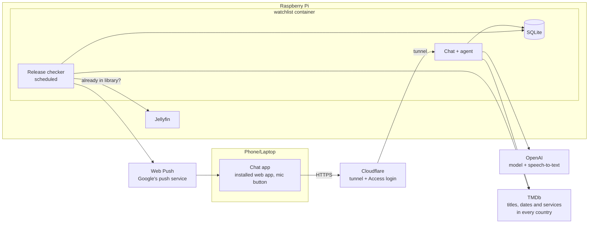
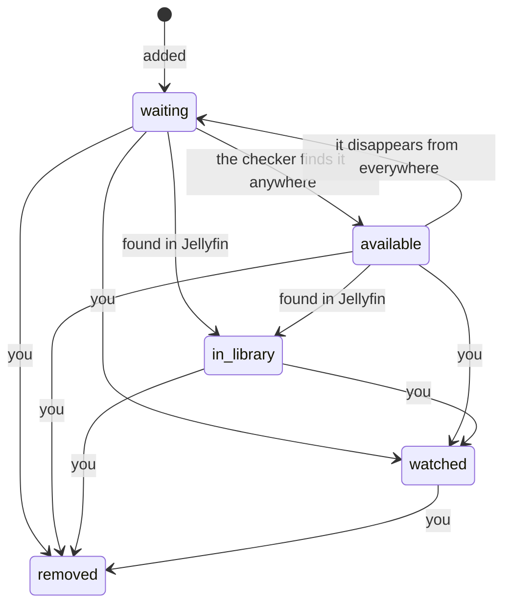

# Watchlist: spec

Status: **build steps 1–3 deployed** at `chat.upendragusain.co.uk`, plus **downloading through Radarr** (2026-10-17; see [Downloading](#downloading)). Code in [services/watchlist](../services/watchlist/). Written 2026-10-17. The "how it works now" story is in [media-server.md](media-server.md); this stays as the design record.

## 1. Purpose

Finding what to watch, and knowing when it's out, takes the most time. Two goals:

1. **Adding something takes five seconds, from anywhere.** You type or say a rough description, such as "that new Zach Cregger horror" or "the show with the severed office workers". The app works out which title you mean and saves it.
2. **You never have to check release dates.** The app watches every saved title and tells you when it first becomes watchable at home **anywhere in the world**, when it reaches a UK service you pay for, and when it's in your own Jellyfin library.

## 2. The parts

| Part | What it does |
| --- | --- |
| **Chat app** | A web page you install to your phone's home screen (a PWA), also usable on the laptop. It has two screens: the **chat**, with a mic button, and the **list**, where you can see and edit everything saved. It receives push alerts even when closed. |
| **Chat + agent** | Takes your message (text, or voice turned into text), and has an OpenAI model with a few **tools** decide what you want and which title you mean. |
| **Release checker** | Runs on a schedule, looks up every saved title, compares the result with the last check, and sends an alert when something changes. |
| **SQLite database** | The watchlist itself, plus what the checker saw last time. |

**One program, two parts.** The chat and the checker are separate parts in the code: they share only the database and run as separate background jobs. They're deployed as **one container**, because at this size a second container buys nothing. If one ever needs to move, the split is already clean.

## 3. How you use it

### Adding

> **You:** add that horror where all the kids run out of the house at night
> **App:** Added **Weapons** (2025, film). [poster] · *Undo*

> **You:** 🎤 "severance"
> **App:** Added **Severance** (2022, TV). I'll tell you when season 3 is announced. · *Undo*

> **You:** add dune
> **App:** Which one? · *Dune (2021)* · *Dune: Part Two (2024)* · *Dune (1984)* · *Dune: Prophecy (TV)*

The rules:

- **One clear match:** add it straight away and offer **Undo**.
- **Several close matches:** show up to 4 buttons and add nothing until you tap one.
- **No match:** say so and ask for more detail. **Never guess silently.**
- **Saying it:** "add …", "I want to watch …", "get me …", "download …", "put … on my list" all add. Questions ("where can I watch …", "is … out yet") and ordinary chat save nothing.
- **Each opening of the app is a new conversation:** the screen starts empty and the agent remembers only what's said since.

### Downloading

Every **film** on the list is downloaded, through the *arr stack on the Pi (see [media-server.md](media-server.md#the-arr-pipeline-public-domain-titles)), which uses **legal indexers only**. TV isn't downloaded yet.

1. Adding a film also adds it to **Radarr** (quality profile *Watchlist*, library `/data/library/movies`) and starts a search. Saying it again for a film already on the list re-sends it if it never reached Radarr.
2. Radarr searches through Prowlarr, picks a release, and hands it to the Pi's qBittorrent. When it's done, Radarr hard-links it into the library, which Jellyfin shows.
3. **Radarr's webhook** tells the watchlist what happened, and the card moves along: *looking for a copy* → *downloading* → **in library**, with a push alert "Downloaded: it's in your library."
4. **Safety nets:** if Radarr can't be reached, the film is marked *sending to Radarr* and re-sent every 5 minutes. The daily check asks Radarr about every film still in progress, in case a webhook was missed.
5. **Wrong title** drops the old film from Radarr (with its file) and sends the right one. **Deleting a card doesn't touch Radarr**; delete the film in Radarr too if you want the file gone. Deleting a film in Radarr puts its card back to a normal release-tracking card.

### Asking

| You say | You get |
| --- | --- |
| "what's on my list" | Saved titles, grouped: *not out yet* · *in cinemas* · *to rent/buy* · *on your services* · *in your library* |
| "where can I watch The Bear" | UK services, rent and buy options right now. **Saves nothing.** |
| "what's coming out soon" | Saved titles with a home release date (anywhere) in the next 30 days |
| "remove dune" / "watched weapons" | Stops tracking it (after confirming which one, if unclear) |
| "no, the other one" | Fixes the last thing it did. The agent sees the last few messages of this conversation. |

### The list

The app's second screen, beside the chat. It's the full watchlist, kept up to date by both the chat and the checker. A title you add in the chat, or one that becomes available overnight, is there next time you open it.

Each title is a card showing:
- poster, title, year, film or TV;
- **status:** *waiting* or *available*;
- **where to watch:** the earliest home release anywhere first, then UK services, rent and buy options (yours highlighted), then other countries;
- **dates:** cinema, digital and disc release, the earliest anywhere plus the UK's, or the next season's premiere;
- what you typed when you added it, and when;
- when it was last checked.

You can manage it by hand, without the chat or the AI:

| Action | Does |
| --- | --- |
| **Delete** | Stops tracking it. *Undo* for a few seconds. |
| **Watched** | Moves it to the *Watched* tab |
| **Wrong title** | A plain TMDb search box. Pick the right one and it replaces the match, and the next check runs straight away. |
| **Snooze** | Hides it, and its alerts, until a date |
| **Check now** | Runs the release check for this title immediately |
| **Notes** | Free text, e.g. "Sam recommended" |

There are filters for *All* · *Waiting* · *Available* · *Watched*, and a search box.

### Being told

Alerts arrive as phone notifications. Tapping one opens that title's card on the list, with **Watched** · **Remove** · **Remind me in a week** buttons.

## 4. The agent

- **Model:** a small, inexpensive OpenAI chat model, set in configuration and chosen at build time. A few messages a day should cost pennies a month.
- **How it works:** OpenAI's built-in **tool calling**. The model is told what the tools are and picks one; the app runs it and hands back the result; this repeats until the model gives an answer. It's capped at **6 tool calls per message**.
- **Tools:** written once in C#, shaped so they could later be offered as an **MCP server** as well, so other AI apps could use the same watchlist. That's not part of the first version.

| Tool | Does |
| --- | --- |
| `search_titles(query, type?, year?)` | TMDb search across films and TV |
| `search_person(name)` / `person_credits(id)` | For "the new one from the Barbarian director" |
| `get_title(tmdb_id, type)` | Details, to confirm a guess |
| `add_item(tmdb_id, type)` | Save it. Refuses duplicates and says it's already there. |
| `remove_item(id)` / `mark_watched(id)` / `snooze_item(id, days)` | Change a saved title |
| `list_items(filter?)` | What's saved, with current status |
| `where_to_watch(tmdb_id, type)` | Services, rent and buy options right now: the UK and the earliest elsewhere |
| `ask_user_to_choose(options[])` | Show buttons instead of guessing |

- **What it can't do:** the tools are limited to the watchlist and TMDb. It has no file, shell or network access beyond them, so a strange title or description can't make it do anything else.
- **Guessing:** the model may use its own knowledge to guess a title from a description, but **every guess must be confirmed against TMDb** before it's saved. This also covers films newer than the model's training.

### Voice

- The mic button records audio in the browser and sends it to OpenAI's **speech-to-text**.
- The text shows in the chat box **before it's sent**, so a misheard word can be fixed. One tap sends it.
- Using the same method everywhere means it works the same on the phone and on any laptop browser.

## 5. The release checker

### What it checks (every country)

| Source | For |
| --- | --- |
| TMDb release dates, all regions | Cinema (types 2 and 3), digital (4), disc (5), per country |
| TMDb watch providers, all regions | Streaming (`flatrate`), `free` and `ads` services, `rent`, `buy`, per country (one call returns every country) |
| TMDb TV details | New seasons announced, season premiere dates, show ended or cancelled |
| Jellyfin API | Whether the title is already in your library (matched by TMDb ID) |

### When

- **Once a day**, at 06:00, or at the first chance after it if the Pi was off. The app wakes every 5 minutes to see whether the check is due and to send waiting alerts.
- **Straight after adding**, so the first answer already says where it's showing. That first check sends no alerts, because the chat reply has just said it all. Fixing a wrong title works the same way.
- **"Check now"** on a card runs the same check as the daily one, alerts included.
- Titles that left tracking (see below) aren't checked again.

### Alerts: only on changes

Each check is saved. An alert fires only when the result is **different from the last check**:

| Alert | Example |
| --- | --- |
| First home release anywhere | "🌍 *Weapons* is out at home: digital in the US since 9 Sep (Apple TV, Prime Video)". This is the alert that matters most. |
| Date announced / moved | "📅 *Weapons*: digital release in the US 9 Sep" · "📅 moved to 16 Sep". The earliest date anywhere, plus the UK date. |
| In cinemas | "🎬 *Weapons* is in cinemas (US, UK)". Information only: it stays *waiting*. |
| On your service | "📺 *Weapons* is now on **Netflix**" (only services in your list) |
| On a free service | "🆓 on BBC iPlayer" (if free services are switched on) |
| Leaving your service | "👋 no longer on Netflix" (it disappeared since the last check; TMDb gives no warning dates) |
| New season | "🆕 *Severance* season 3 starts 14 Jan" |
| In your library | "✅ *Weapons* is on the TV now" |

- **Quiet hours:** alerts found overnight are held until 08:00, so the 06:00 check's alerts arrive at 08:00.
- **One notification per title:** that title's alerts from one check arrive together.
- **"Out at home" is sent once per title**, ever. When it fires, it already lists the UK options, so a separate "to rent or buy" alert isn't sent with it.
- **Snoozed titles** are still checked, so their cards stay up to date, but they send no alerts.
- **Delivery:** if the push service is down, alerts wait and are retried. Devices that have uninstalled the app are forgotten. With no devices at all, alerts are marked sent so they don't pile up.
- **Turning alerts on:** the 🔔 button in the app's header asks for permission and sends a test alert. On a phone, install the app first.
- **Weekly digest**, on Sundays: what's coming out in the next few weeks. It can be switched off.

### What the checker records

On every check, the title's card on the list is updated with **everything found**, in every country: services, rent and buy options, and dates. The card shows the **earliest home release anywhere** first, then the UK details, then a "more countries" list. Alerts are more selective (see the table above): the "first home release anywhere" alert is sent once per title, and streaming alerts are only for UK services you pay for, plus free ones if they're switched on.

### Status

| Status | Means | Checked daily? |
| --- | --- | --- |
| `waiting` | Not watchable at home anywhere yet. It may be in cinemas, or have a date. | yes |
| `available` | Watchable at home somewhere in the world: on any service, free, to rent or to buy in any country, or its digital or disc date has passed in any country | yes, because services change |
| `in_library` | In your Jellyfin library | no (shows keep being checked for new seasons) |
| `watched` | You marked it | no |
| `removed` | You deleted it (kept for history; adding it again brings it back) | no |

**Snoozing** isn't a status: it's a date on the title. Until then, it's hidden from the main list and sends no alerts, but it's still checked, so the card is up to date when it comes back.

## 6. Data

One SQLite file at `/opt/watchlist/data/watchlist.db`.

| Table | Holds |
| --- | --- |
| `items` | TMDb ID, type (film/TV), title, year, poster, status, snoozed-until date, notes, **what you typed** when adding it, added date |
| `items.availability_json` | The last check: release dates, services and season info as found. Each check is compared with it, then replaces it. |
| `alerts` | Per item: kind, message, created, sent. Unsent ones wait through quiet hours. |
| `messages` | Chat history, by conversation (one per opening of the app). The agent sees the last few of the current one; the rest is kept only for the daily limit's count |
| `push_subscriptions` | The devices that receive alerts |
| `meta` | The Web Push signing key (made on first start) and when the daily check last ran |

Settings live in `/opt/watchlist/data/settings.json` (example: [pi/watchlist/settings.example.json](../pi/watchlist/settings.example.json)), and changes apply without a restart:
- `MyServices`: your UK subscriptions, by name as TMDb spells them, e.g. "Amazon Prime Video", "Disney Plus". A name matches any provider that starts with it, so "Netflix" also covers "Netflix Standard with Ads";
- `FreeServicesCount`: whether free services count;
- `CheckAt`: when the daily check runs (06:00);
- `QuietFrom` / `QuietUntil`: quiet hours (22:00 to 08:00).

## 7. Access and security

- **Address:** `chat.upendragusain.co.uk`, a hostname on the existing Cloudflare tunnel, routed to `http://localhost:8190`. The tunnel runs as the `cloudflared` system service on the Pi, with its config in `/etc/cloudflared/config.yml`, not in the public risky-business repo.
- **Lock 1, Cloudflare Access** (Zero Trust team `upendragusain`, free plan):
  - the application *chat* covers the whole hostname;
  - its policy *Only me* allows only `upendra.gusain@gmail.com`, logging in with an emailed one-time code (no identity provider is set up);
  - a login lasts 1 month.
  - Strangers never reach the Pi.
  - This applies only to this hostname. The website and risky-business are unchanged.
- **Lock 2, the app checks too:** every request must carry Cloudflare's signed login token (the `Cf-Access-Jwt-Assertion` header), checked against your Cloudflare team's public keys and this application's ID. That way the app still refuses strangers if Access is ever switched off by mistake.
- **Listening:** the container listens on `127.0.0.1` only, so nothing on the home network can reach it without going through Cloudflare.
- **Later, for scripts and shortcuts:** a Cloudflare **service token**, e.g. for a "Hey Google" shortcut.
- **Cost guard:**
  - a hard monthly spending limit on the OpenAI account;
  - the app also stops calling OpenAI after **200 messages a day**.
- **Secrets** go in `/opt/watchlist/.env` on the Pi (mode 600), never in the repo and never printed:
  - the OpenAI key;
  - the TMDb read token;
  - the Jellyfin API key;
  - the Cloudflare team name and application ID;
  - the app's own address, which Web Push sends as the sender.

  The Web Push signing key is made by the app on first start and kept in the database.
- **Credit:** TMDb's terms ask apps to credit TMDb, and the streaming data comes from **JustWatch**, which must be credited too. Both go in the app's footer.

## 8. Deployment

| | |
| --- | --- |
| Code | `services/watchlist` in this repo. C#, .NET 10 (latest LTS, as in `tools/media-tidy/global.json`), ASP.NET Core serving both the API and the page. |
| Tests | Unit tests for the alert logic (old check vs new → which alerts) and for the agent's tool handling, using recorded TMDb and OpenAI responses. |
| Image | Built for arm64, base image pinned to an exact version at least two weeks old |
| On the Pi | `/opt/watchlist`: `compose.yaml`, `.env`, `data/`. Copy of `compose.yaml` in `pi/watchlist/`. |
| Runs as | User 1000, limited to 1 CPU, so Jellyfin and the website keep theirs |
| Network | The *arr stack's Docker network (`arr_arr`), so it and Radarr can call each other; published on the Pi's `127.0.0.1:8190` only, for the tunnel. Jellyfin is at `host.docker.internal:8096` |
| Backups | `data/` joins the off-Pi backups (roadmap item 5) |
| Health | A `/health` page for the container, and errors logged to the container log |

## 9. Out of scope

- **Downloading TV.** Films go to Radarr (see [Downloading](#downloading)); shows could go to Sonarr the same way later. MediaTidy keeps filing whatever arrives in `C:\qBittorrent` on the laptop, however it got there.
- **Recommendations** ("what should I watch?"). Possibly later, using TMDb's recommendations for titles you marked watched.
- **Native Android app, Telegram, Trakt sync:** possible later front ends or mirrors that talk to the same service. Not needed for the first version.

## 10. Build order

1. **The core:**
   - the service, database and TMDb client;
   - the agent with `search`, `add`, `list`, `remove` and `where_to_watch`;
   - the chat page, without voice or push yet;
   - **the list page**, with delete, watched and "wrong title";
   - the Cloudflare hostname and Access.
2. **The checker:** daily checks, filling in each card's services and dates, `waiting` → `available`, alerts with Web Push, and quiet hours. Snooze, notes and "check now" on the list.
3. **Voice:** the mic button, speech-to-text, and the edit-before-send box.
4. **Jellyfin:** detecting "in your library", plus the Watched / Remove / Snooze buttons on alerts.
5. **TV:** new seasons and premiere dates.
6. **Extras:**
   - the weekly digest;
   - a "Hey Google" shortcut using a service token;
   - the MCP server;
   - marking a title `watched` automatically once Jellyfin says you've played it through.

## 11. Still to decide

1. **Your UK subscriptions** (Netflix, Prime, Disney+, NOW, Apple TV+, …) and whether **iPlayer, ITVX and Channel 4** count.
2. **TV alerts:** only new seasons and premieres (suggested), or every new episode too?
3. **Keys you'll need to create:**
   - an OpenAI API key, with a spending limit set;
   - a TMDb account and API read token;
   - a Jellyfin API key (Dashboard → API Keys).
